<p align="center">
  
</p>

# 책빌리지 (Book Village) — 작은도서관 도서 대여 관리 프로그램

> ## 🎉 책빌리지 1호점이 문을 열었습니다!
>
> 아파트 단지 안 작은도서관 **1호점**이 실제로 책빌리지로 운영을 시작했습니다.
> 도서 등록부터 주민 셀프 대여, 독서 퀴즈·독서록·젤리 포인트까지 — 스마트폰 하나로 무인 운영되고 있는 생생한 현장 이야기를 확인해 보세요.
>
> ### 👉 [책빌리지 1호점 운영 이야기 보러 가기 (블로그)](https://blog.naver.com/dean_studio_/224386820985)
>
> 🧒 **유치원·어린이집이라면** 아이들이 QR 회원카드로 직접 빌리는 [유치원 모드](#kindergarten)를 보세요. (2호점 유치원에서 운영 중)
>
> 🎓 **영어학원이라면** 원서마다 AR 레벨을 붙여 두고 학생이 자기 레벨 책을 골라 빌리는 [학원 모드](#academy)를 보세요. (반별 대출·연체, AR 퀴즈 통과 기록, 레벨 라벨 인쇄)

<table>
<tr>
<td>

### ✦ 우리 도서관에 꼭 맞게 — AI와 함께 고쳐 쓰는 책빌리지

책빌리지는 **아파트 · 학교 · 마을 · 유치원 · 학원** 등 여러 운영 방식을 하나의 코드로 지원합니다. 그만큼 모든 도서관의 방식을 처음부터 그대로 담아낼 수는 없습니다.

그래서 처음부터 **고쳐 쓰기 좋은 구조**로 설계했습니다.

- 화면, 서버 기능, 데이터베이스가 역할별로 깔끔하게 나뉘어 있습니다
- 운영 방식(모드)마다 기능을 켜고 끄는 기준이 한곳에 모여 있어, 한 모드를 고쳐도 다른 모드에 번지지 않습니다
- 데이터베이스 변경 이력이 번호 순서대로 남아 있어 어떤 사이트에도 같은 구조를 재현할 수 있습니다

이 구조 덕분에 **Claude Code**나 **Codex** 같은 AI 코딩 도구에 *"우리 도서관은 반마다 대출 기간을 다르게 하고 싶어요"* 처럼 평소 말로 요청하면, AI가 코드를 읽고 알맞은 곳을 정확히 고쳐 줍니다. AI가 가장 먼저 읽도록 구조와 규칙을 정리한 안내서 [`AGENTS.md`](AGENTS.md)도 함께 들어 있습니다.

**월 2~3만 원대 AI 구독**(Claude Pro, ChatGPT Plus 등)이면 충분합니다. 기본 기능으로 먼저 운영해 보시고, 우리 도서관만의 방식이 필요해지면 AI와 함께 한층 더 완성도 있게 다듬어 보세요.

</td>
</tr>
</table>

## Versions

### v0.9

- **학원 모드 · AR 레벨 원서 대여** ([자세히 보기](#academy)) — 사이트 유형에 '학원' 추가(반으로 학생 구분, QR 회원카드 로그인). 학원을 고르면 QR 카드 로그인·관리자만 회원 생성·대출 기간 7일·AR 정보·원서 보충 조회가 한 번에 설정됨
  - 바로 가기: [사이트 유형](#academy-site-type) · [AR 설정](#academy-ar-settings) · [책 AR 정보](#academy-book) · [일괄 등록](#academy-import) · [AR 정보 입력표](#academy-ar-missing) · [반별 현황](#academy-classes) · [AR 통과 체크](#academy-return) · [AR 랭킹](#academy-ranking) · [학생 상세](#academy-student) · [레벨 라벨](#academy-labels) · [학생 화면](#academy-student-app) · [필요한 것](#academy-need)
- **AR 레벨 정보** ([화면 보기](#academy-book)) — 설정으로 켜면 도서 등록·수정·상세에 Book Level·Points·Quiz No·Interest·단어 수·Lexile 칸과 'AR 찾기'(AR BookFinder) 버튼. 학생 도서 검색에 레벨대·Interest 칩, 레벨순 정렬, 책마다 BL 배지. 사이트 유형과 별개라 아파트·학교 도서관에서도 켤 수 있음 (끄면 지금과 똑같음)
- **원서 ISBN 보충 조회** — 카카오 도서 검색에 없는 원서는 Open Library에서 제목·저자·출판사·표지를 가져옴 (설정으로 켜기)
- **반별 현황 · 반 관리** ([화면 보기](#academy-classes)) — 반마다 학생·대출·연체 수, 학생별 레벨(ZPD)·빌린 책·최근 반납과 AR 통과. 반 이름 변경(학생 반도 함께), 반 이동, 퇴원(퇴원생은 대출·카드 인쇄·랭킹에서 제외). 학생 등록·상세에 학년·레벨 범위(ZPD)
- **엑셀(CSV) 일괄 등록** ([화면 보기](#academy-import)) — 도서·AR 정보·학생을 엑셀 표 붙여넣기 또는 CSV로. 미리보기에서 줄마다 확인, 같은 파일을 다시 올려도 복본·중복 학생이 생기지 않음. AR 정보 없는 책만 모아 표로 입력하는 화면
- **AR 퀴즈 통과 기록 · AR 포인트 랭킹** ([화면 보기](#academy-return)) — 반납 화면·반별 현황·학생 상세에서 선생님이 통과를 체크하면 포인트·단어 수가 쌓임(젤리와는 별개). 랭킹에 AR 포인트 탭(반 필터, 한국 시간 기준), 학생 내 서재에 AR 독서 카드·'내 레벨 책'
- **레벨 라벨 인쇄** ([화면 보기](#academy-labels)) — 책등에 붙이는 AR 레벨 라벨(23.5×36mm, A4 한 장에 56개), 레벨대별 색 띠
- **사이트 유형 판별 정리** — 모드 판별을 `src/lib/site-mode.ts` 한 곳으로 모음. 모르는 유형 값이 저장돼 있어도 로그인 화면이 멈추지 않게 수정, 사이트 유형·프리셋 저장 실패 시 오류 표시
- **AI로 고쳐 쓰기 안내 · `AGENTS.md`** — README 상단 안내와 AI 코딩 도구가 먼저 읽는 구조·규칙 안내서 추가
- **DB** — `00032_ar_fields.sql`(도서 AR 칸, 설정 값 길이 제한 해제), `00033_academy.sql`(학생 학년·레벨·상태, AR 통과 기록). 칸·표 추가만 해서 기존 사이트에는 영향 없음

### v0.8

- **시리즈 목록** — 관리자 메뉴에 시리즈별 현황 추가. 누적 대출 인기순으로 마지막 권, 가진 책 수(2부 표시), 빠진 권 번호를 보여주고 펼치면 권별 위치·대출 횟수. 시리즈 이름이 없는 책도 제목 뒤 번호로 묶음
- **유치원 모드 보강** ([화면 보기](#kids-kiosk)) — 리더기 대기 화면에서 카드 없이 책 바코드만 찍으면 바로 반납, 대출 중에 잃어버린 책 분실 삭제, 도서 상세에서 삭제
- **책장 이동 개편 · 폐기 도서** — 책장을 고르면 지금 그 책장에 있는 책 목록 표시, 폐기 도서 메뉴 분리
- **비회원 목록** — 비회원 정보 수정, 같은 사람 중복 합치기, 삭제
- **공지사항 게시 기간** — 시작일~종료일에만 주민 화면에 표시 (비워 두면 제한 없음)
- **수기 대여 안내문 새 디자인 + 수기 대여 노트(가로 A4)** — 앱을 안 쓰는 분들을 위한 종이 대장
- **월별 신간 표지형 인쇄 수정** — A4 한 장에 맞춰 자동 축소할 때 한 줄 권수가 고른 값보다 늘어나던 문제
- **도서 정보 조회는 카카오만 사용** — 알라딘 API 서비스 종료(2026-10-30)에 따라 알라딘 조회 스크립트 삭제
- **기타** — 서재 배치도 AB열까지 확장, 저작권자 표기를 딘웍스로 변경

### v0.7

- **유치원 모드 · QR 회원카드** ([자세히 보기](#kindergarten)) — 사이트 유형에 '유치원' 추가(반으로 아이 구분). 관리자가 QR 회원카드를 발급·재발급하고 반별로 A4 인쇄(85×50mm, 한 장에 10장). 보호자 연락처·메모 저장. 로그인 화면에서 카드를 리더기에 찍으면 바로 로그인
  - 바로 가기: [사이트 유형](#kids-site-type) · [로그인·대출 방식](#kids-access) · [아이 등록·카드 발급](#kids-member) · [카드 인쇄](#kids-card-print) · [리더기 대출·반납](#kids-kiosk) · [필요한 것](#kids-need)
- **로그인·대출 방식 설정** ([화면 보기](#kids-access)) — 로그인 방식(휴대폰/QR 카드), 회원 가입(본인 가입/관리자만), 홈 화면 리더기 대출과 자동 로그아웃 시간을 지점별로 설정. 유치원 선택 시 한 번에 적용
- **리더기 대출(키오스크)** ([화면 보기](#kids-kiosk)) — 대여하기 화면에서 회원카드 찍기 → 책 바코드 찍기 → 자동 대출 → 일정 시간 뒤 자동 로그아웃. 리더기가 한글 입력 상태로 찍어도 자동 복원
- **도서 분류** — 연령(0~3세·4~7세·초등 1~2/3~4/5~6학년·청소년·일반), 유아 하위 분류(놀이·그림책·교양·학습·캐릭터), 전집(시리즈) 이름, 교과연계 학년. 분류별·책장별 보기, 옮겨야 할 책 강조, 전집 이름 일괄 변경(오타로 갈라진 전집 합치기), 분류 목록 인쇄. 알라딘·교보 정보로 일괄 분류하는 스크립트(`scripts/classification`)
- **책장 이동** — 옮길 책장을 고르고 바코드(리더기·카메라)를 찍으면 바로 이동, 되돌리기 지원. 재배치안 자리와 다르면 경고
- **자료실** — 인쇄용 파일(pdf·한글·워드·엑셀 등)을 올려두고 도서관 PC에서 원래 파일 이름으로 내려받기
- **월별 신간 인쇄 — 목록형** — 분류·제목 표 + 양옆 표지 기둥. 표지 수·표지 크기·글자 크기 조절, A4 한 장 자동 맞춤. 기존 표지형도 선택 가능
- **비회원 대출 개편** — 동/호수만 입력하면 이전에 빌려 간 분이 바로 후보로 떠서 한 번에 선택(회원/비회원 표시, 대출 횟수). 누구 → 연락처 → 책 → 확인 단계로 진행, 제목 검색과 바코드 스캔을 한 칸에서, 책 상세 보기, 휴대폰에서도 큰 글씨·큰 버튼
- **기타** — 지점별 홈 화면 앱 이름(`NEXT_PUBLIC_APP_NAME`), 관리자 메뉴 스크롤, 1,000권이 넘어도 서재별 도서 수 정확히 표시, 새 지점 설정 저장·셀프 대출 권한 수정

### v0.6

- **월별 신간도서** — 관리자가 매월 신간을 등록해 주민에게 공개. 교보/온라인 서점 링크만 붙여넣으면 제목·표지 자동 추출(직접 입력도 지원), **연령별 분류**(유아·어린이·청소년·성인), 순서 조정·수정·삭제
- **신간도서 A4 인쇄** — 게시용 인쇄 미리보기. 한 장에 자동 맞춤(내용량에 따라 자동 축소), 한 줄 권수·크기 수동 조절, 제목은 고정 크기 유지, 도서관 이름 자동 표기. 분류(유아·어린이·청소년·성인)는 섹션으로 나누지 않고 순서대로 쭉 나열하되 **색상으로만 구분**(번호 배지·표지 테두리·상단 색 범례)
- **구매 영수증 관리** — 월별 도서 구매 영수증 **이미지·PDF 업로드**(여러 장, PDF는 페이지별로 한 장씩 자동 저장)·메모·순서 조정·삭제, 정산/보고용 인쇄
- **독서록 전용 에디터** — 반납 도서 독서록을 풀스크린 전용 화면에서 작성. 큰 별점 버튼, 작성 가이드 힌트(탭하면 질문이 입력창에 삽입), 하단 고정 등록 버튼으로 편하게 작성
- **내 독서록 모아보기** — 내 서재에 '내 독서록' 메뉴 추가. 내가 쓴 독서록을 별점·감상문·작성일과 함께 모아 보기(작성 편수 배지)
- **퀴즈 없는 책은 퀴즈 버튼 숨김** — 등록된 퀴즈가 없는 도서는 반납완료 목록에서 퀴즈 버튼을 아예 표시하지 않음

### v0.5

- **비회원(게스트) 대출** — 앱 가입 없이 종이에 적고 가는 이용자를 동/호수·이름·전화번호로 등록해 대여. `101-211` 입력 시 `101동 211호` 자동 변환, 도서 제목 검색으로 여러 권 한 번에 처리, 대출일 지정 가능. 게스트는 젤리 미지급·권수/연체 제한 없음. 대여중/연체/반납 목록에 '게스트' 배지 표시, 대출 정보(이름·동호수·대출일) 사후 수정 가능
- **공지사항** — 관리자 공지 작성/이미지 첨부/관리, 주민 접속 시 팝업 노출 + 내 서재·하단 네비 미읽음 배지 + 목록 열람
- **주민 대여 취소** — 대여 당일에 한해 주민이 직접 취소 (지급된 대출 젤리 자동 회수)
- **제목으로 대여** — 대여하기 화면에서 바코드 없이 도서명으로 검색해 셀프 대여, 최근 검색어 저장, 동일 제목 여러 권일 때 바코드 유형 선택
- **제목 검색 반납** — 반납 페이지에서 바코드 없이 도서명/대여자로 검색해 반납
- **반납 내역 개선** — 기간·검색 필터, 페이지네이션, 처리자 표시
- **관리자 독서록 열람** — 전체 독서록 목록/검색/페이지네이션
- **주민 PIN 재설정** — 관리자가 주민 상세에서 비밀번호(PIN 4자리) 초기화
- **회원가입 비밀번호 재확인** — PIN 재입력 단계 추가(색상 구분), 불일치 시 즉시 재입력
- **도서 정보 수정** — 관리자 도서 상세에서 제목·저자·출판사·서가 위치·표지 직접 수정
- **실제 ISBN 직접 입력 등록** — 카카오 검색이 안 되는 도서를 ISBN 직접 입력으로 등록(중복 자동 검사)
- **바코드 스캔 한글 IME 복원** — 리더기가 한글 입력 상태로 `BV`를 `ㅠㅍ`처럼 찍는 문제 자동 복원
- **가나다순 자연 정렬** — 도서 목록 제목순 정렬 시 `전천당 1, 2, …, 10` 순서 유지
- **자체 바코드 대량 인쇄** — 한 번에 최대 1,000장 생성·인쇄
- **로고 인쇄** — 도서관 로고 스티커 인쇄 페이지
- **홈 화면 추가(PWA)** — manifest·앱 아이콘 적용으로 스마트폰 홈 화면에 앱처럼 설치
- **대시보드 카드 클릭 이동** — 통계 카드 클릭 시 해당 목록으로 바로 이동
- **도서 상세 서가 미니맵** — 위치 서가를 확대·강조(펄스 애니메이션)해 찾기 쉽게 표시
- **검색 상태 유지** — 도서 검색 후 뒤로가기 시 검색어·결과 보존
- **무인 도서관 이용 안내문** — 인쇄용 A4 가이드(앱 안내 / 수기 대여 / 최대 5권 등)

### v0.4

- 랜딩 페이지 추가 — 로고 + 로그인/회원가입 버튼
- 회원가입 시 개인정보 수집·이용 동의 단계 추가 (내 서재에서도 처리방침 열람 가능)
- 자체 바코드 생성·인쇄 페이지 — 없는 번호 자동 발급(BV…), 로고 포함, 스티커 규격 인쇄 레이아웃
- 자체 도서 등록 전용 페이지 — 도서명 카카오 검색으로 정보 자동 채움, 자체 바코드 자동완성(숫자→BV000xxx), 등록 확인 단계
- 전체 도서 목록에 표지 썸네일 표시 + 일괄 선택 후 서가 위치 수정
- 대여하기 화면 — 카메라 스캔 / 리더기 스캔 선택 버튼
- 도서 표지 업로드 시 자동 축소(용량 절감), 클립보드 이미지 붙여넣기 지원
- 등록/대출 처리자(담당 사서) 기록 + 관리자 이름 표시
- 서가 그리드 개선 — 서재 리사이징, 분류별 색상 구분, 이름 줄바꿈

### v0.3

- 주민 로그인 방식 개선 — 휴대폰 번호 없이 **동 → 호수 → 비밀번호**로 로그인 (같은 세대 여러 명도 비밀번호로 구분)
- 회원가입 호수 입력 4자리 지원 (예: 1104호)
- 바코드 스캔 인식 개선 — 부가기호(가격기호)가 붙은 **한국 도서 EAN-13 바코드** 인식 (전체 스캐너에 인식 포맷 명시 + 스캔 영역 최적화)
- 브랜딩 커스터마이징 — 도서관 이름 기반 페이지 제목, OG 이미지·파비콘 적용 (SNS 공유 미리보기 지원)

### v0.2

- 카카오톡 채널 연동 (관리자 설정 > 채널 ID 입력 → 로그인/내 서재에 상담 버튼)
- 회원가입 확인 단계 추가 (입력 정보 요약 → 확인 후 최종 가입)
- 도서 등록 3가지 모드 (연속 등록 / 단일 도서 등록 / 중복 도서 등록)
- 연속 등록: 바코드 연속 스캔 → 하단 썸네일 목록 → 일괄 등록
- 단일 도서 등록: 1권씩 상세 정보 확인 후 등록
- 중복 도서 등록: 이미 등록된 ISBN 도서를 자체 바코드로 추가 등록
- 바코드 스캔 전체 화면 (프레임 제거, 카메라 영역 확대)
- 스캔 중 카메라 라이트(토치) ON/OFF 지원
- 연속 스캔 중 중복 바코드 감지 시 토스트 경고 + 스캔 유지
- 소프트 삭제 도서 재등록 시 자동 복원 (바코드 충돌 해결)

### v0.1 — 최초 커밋

---

## 소개 
> 관리비 0원으로 운영하는 작은도서관 도서 대출/반납 관리 시스템

아파트, 학교, 마을 작은도서관을 위한 **무료 오픈소스 도서관 관리 프로그램**입니다. 바코드 스캔으로 도서 대여/반납, 도서 검색, 연체 관리, 독서 퀴즈, 독서록까지 — 스마트폰 하나로 도서관을 운영할 수 있습니다.


## 왜 만들었나요?

> *"관리할 사람이 없어서 닫히는 도서관이 하나라도 줄었으면 합니다."*

아이를 키우면서 동네 작은도서관을 자주 찾습니다. 그런데 사람이 없어 문을 닫거나, 운영을 포기하는 곳이 점점 늘어나고 있었습니다.

수기 장부, 엑셀 대장, 수작업 연체 관리... **아날로그 방식의 도서관 운영은 자원봉사자에게 너무 큰 부담**입니다. 결국 지치고, 포기하게 됩니다.

하지만 **아이들에게 도서관은 특별한 공간**입니다. 책을 직접 만지고, 고르고, 읽는 경험은 어떤 디지털 콘텐츠로도 대체할 수 없습니다. 이 공간이 사라지는 건 너무 아까운 일이었습니다.

그래서 직접 만들었습니다.

- **스마트폰 하나면 충분합니다** — 누구나 사서가 될 수 있고, 주민은 셀프 대여까지 가능합니다
- **관리비 0원** — Vercel + Supabase 무료 플랜으로 운영비가 들지 않습니다
- **아이들이 즐거워합니다** — 독서 퀴즈를 풀고, 독서록을 쓰고, 젤리 포인트를 모으며 "오늘 젤리 몇 개 모았어!" 하고 좋아합니다

---

## 테스트 접속 주소 
**테스트 URL**: https://bookvillage-dev.vercel.app

| 구분 | 접속 경로 | 아이디 | 비밀번호 |
|------|----------|--------|---------|
| 주민 | `/login` | 010-1234-1234 | 2022 |
| 관리자 | `/admin/login` | admin | admin1234 |

## 상세 기능 안내와 가이드는 [문서 사이트](https://dean-studio.github.io/bookvillage_app/)에서 확인할 수 있습니다.

### 함께 도서관을 살려요

**이 프로젝트는 동네 작은 도서관이 더 오래 운영되기를 바라는 마음으로 만들었습니다.**

아파트, 학교, 마을 — 어디서든 작은도서관이 있는 곳이라면 바로 사용할 수 있습니다. 환경에 맞게 커스터마이징이 필요하시면 편하게 연락 주세요.

📧 **hckim@dean.kr**

---

## 주요 기능

### 주민
- **셀프 대여** — 바코드 스캔으로 직접 대출 (별도 앱 설치 불필요)
- **도서 검색** — 제목/저자 검색 + SVG 서가 위치 맵
- **내 서재** — 대여 현황, 반납 이력, 알림, 젤리 잔액
- **독서 퀴즈** — 책 반납 후 퀴즈 풀기 (+3 젤리)
- **독서록** — 별점 + 감상문 작성 (+10 젤리)
- **젤리 포인트** — 대출/반납/독서록/퀴즈 활동 시 자동 지급
- **알림** — 반납 D-3, 당일, 연체 알림 + 미읽은 배지
- **추천 도서** — "이 책을 본 사람이 본 도서"

### 관리자
- **도서 등록** — 바코드 스캔 → 카카오 API 자동 완성 → SVG 서가 배치
- **대출/반납 처리** — 바코드 스캔 + 서가 위치 안내 팝업
- **반납 내역** — 처리자 기록, 연체 여부 표시
- **주민 관리** — 목록, 상세, 젤리 수동 지급/차감
- **랭킹** — 기간별 다독왕/인기도서/독서록/젤리 순위
- **통계 대시보드** — 대출/반납/가입 통계, 연체 현황, 신작
- **연체 관리** — 알림 발송 + 대출 자동 제한
- **설정** — 대출 권수, 기간, 젤리 지급량, 퀴즈, 관리자 승인

<a id="kindergarten"></a>

## 유치원 모드 · QR 회원카드

> 책빌리지 **2호점(유치원)** 에서 실제로 쓰고 있는 방식입니다. 아이들이 휴대폰 없이 **QR 회원카드 → 책 바코드** 순서로 찍기만 하면 직접 빌리고 반납합니다.
> 아래 화면은 데모 사이트에서 가상의 원아로 찍었습니다.

**바로 가기:** [1. 사이트 유형](#kids-site-type) · [2. 로그인·대출 방식](#kids-access) · [3. 아이 등록·카드 발급](#kids-member) · [4. 카드 인쇄](#kids-card-print) · [5. 리더기 대출·반납](#kids-kiosk) · [필요한 것](#kids-need)

<a id="kids-site-type"></a>

### 1. 사이트 유형에서 '유치원' 선택

**관리 → 사이트 유형**에서 유치원을 고르면 로그인·대출 방식이 한 번에 유치원용으로 바뀝니다: QR 회원카드 로그인, 관리자만 회원 생성, 홈 화면 리더기 대출 ON.

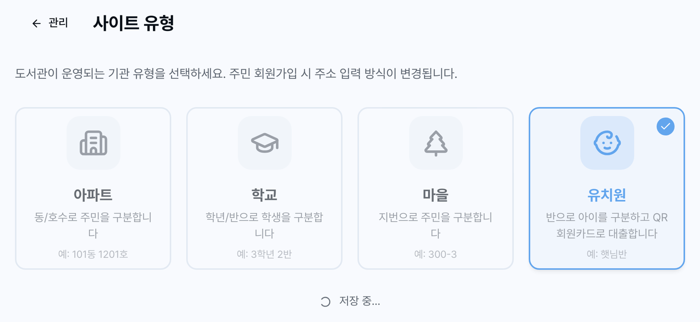

<a id="kids-access"></a>

### 2. 로그인·대출 방식과 반 목록

**관리 → 로그인·대출 방식**에서 로그인 방식(휴대폰+PIN / QR 회원카드), 회원 가입 방식, 리더기 대기 화면 사용 여부, 자동 로그아웃 시간(초), 반(그룹) 목록을 정합니다. 유치원을 고른 뒤에도 하나씩 바꿀 수 있습니다.

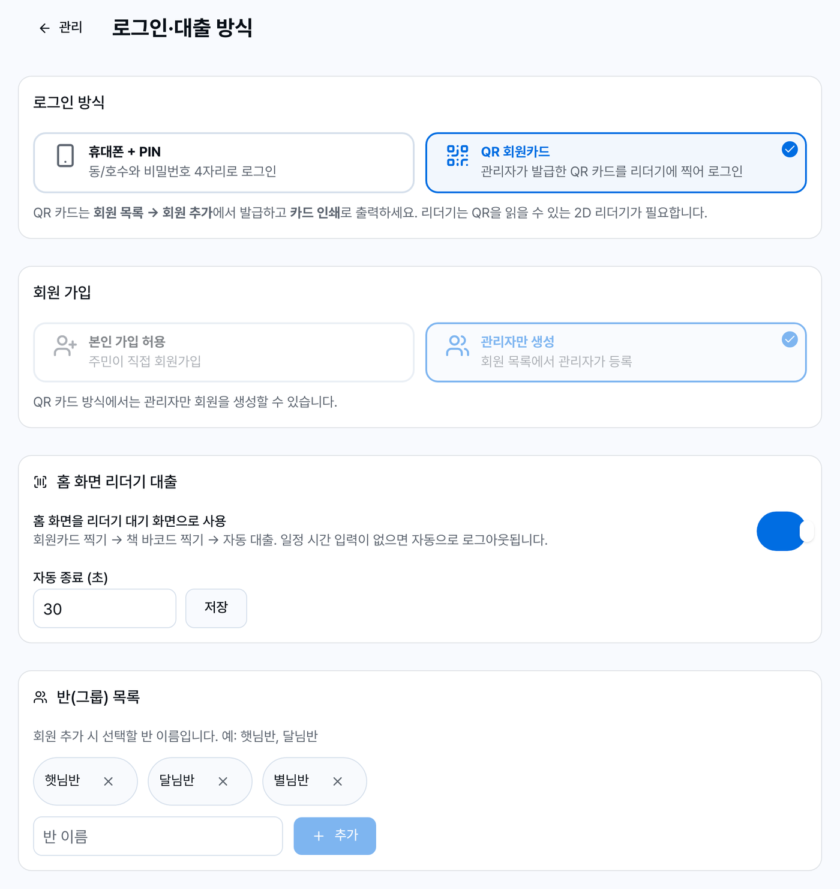

<a id="kids-member"></a>

### 3. 아이 등록과 QR 회원카드 발급

**회원 목록 → 회원 추가**에서 반과 이름만 넣으면 QR 회원카드가 바로 발급됩니다. 보호자 연락처와 메모(형제 관계, 알레르기 등)는 선택입니다. 카드를 잃어버리면 회원 상세에서 재발급하고, 예전 카드는 더 이상 쓸 수 없습니다.

<table>
  <tr>
    <td width="50%">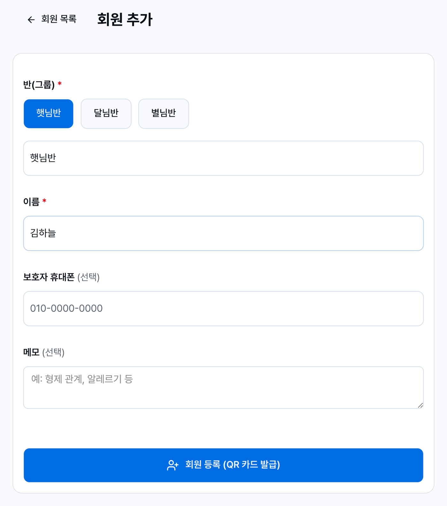</td>
    <td width="50%">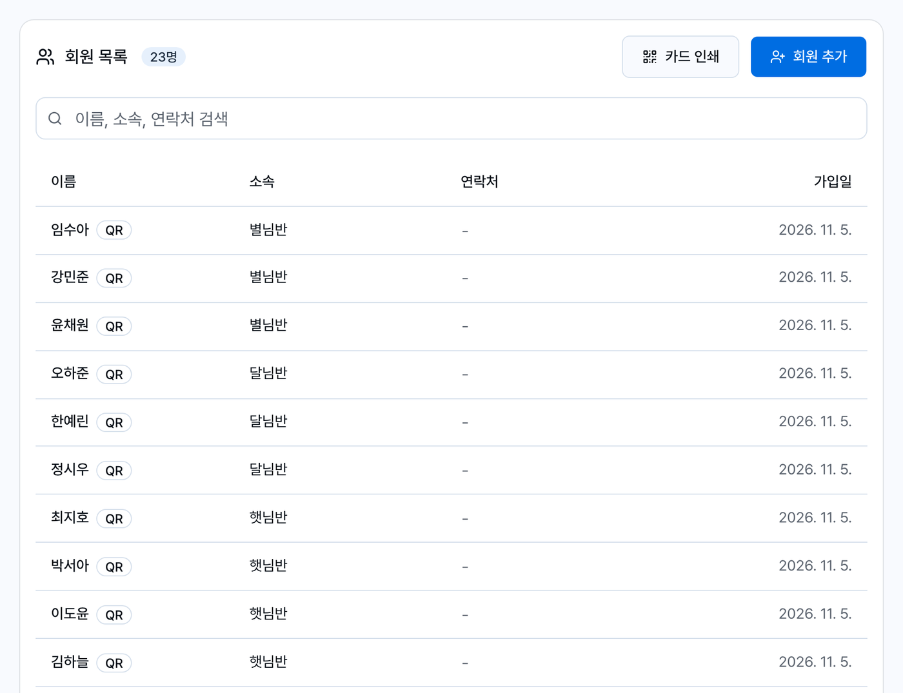</td>
  </tr>
  <tr>
    <td align="center">회원 추가 — 반 + 이름이면 끝</td>
    <td align="center">회원 목록 — 소속에 반, QR 카드 회원 표시</td>
  </tr>
</table>

<a id="kids-card-print"></a>

### 4. 회원카드 인쇄 (A4 한 장에 10장)

**QR 카드 인쇄**에서 반별 또는 골라서 A4로 인쇄합니다. 카드 한 장은 85×50mm(명함 크기)이고 도서관 이름·로고·아이 이름·반이 들어갑니다. 잘라서 코팅하면 오래 쓸 수 있어요.


<a id="kids-kiosk"></a>

### 5. 리더기 대출·반납 (키오스크)

도서관 태블릿이나 PC에 2D 바코드 리더기를 연결해 두면 홈 화면이 **"회원카드를 찍어주세요"** 대기 화면이 됩니다.

1. 아이가 회원카드를 찍으면 이름으로 인사하고
2. 빌릴 책의 바코드를 찍으면 바로 대출됩니다. 여러 권을 이어서 찍을 수 있어요.
3. **다 빌렸어요**를 누르거나 정해 둔 시간 동안 입력이 없으면 자동으로 끝나고 대기 화면으로 돌아갑니다.

반납할 책은 카드 없이 대기 화면에서 책 바코드만 찍으면 됩니다. 리더기가 한글 입력 상태여도 자동으로 고쳐서 읽습니다.

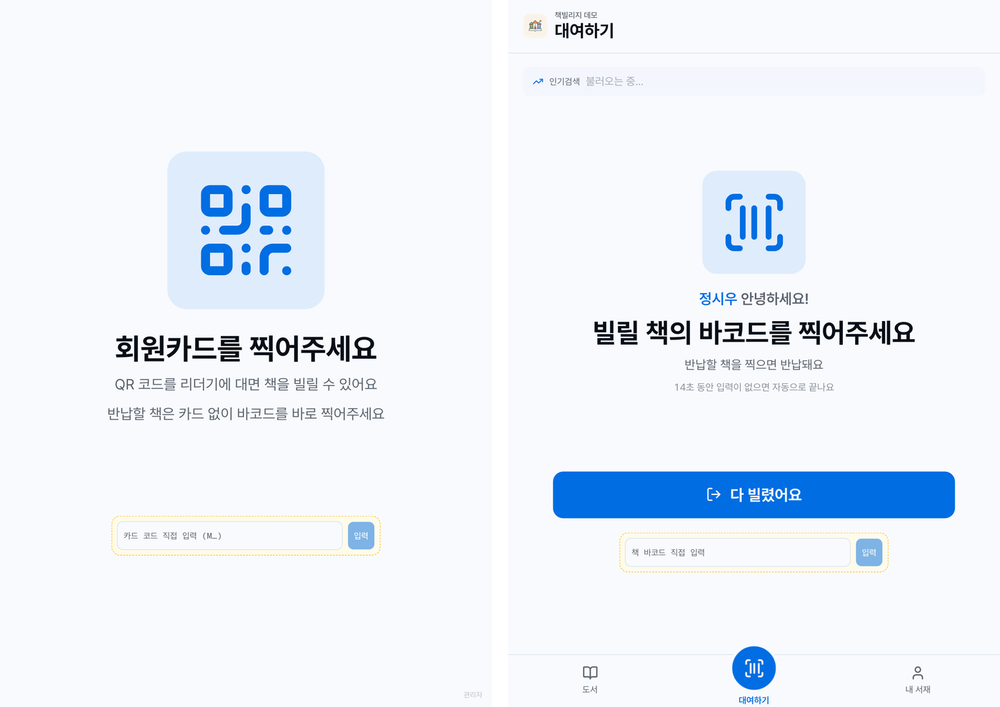

<a id="kids-need"></a>

### 필요한 것

- **2D(QR) 바코드 리더기** — QR 회원카드를 읽어야 해서 1D 전용 리더기는 안 됩니다. USB로 꽂으면 키보드처럼 입력되는 일반 제품이면 됩니다.
- 대출용 태블릿 또는 PC 1대 (브라우저만 있으면 됨)
- 책에 붙일 바코드 — 책 뒤의 ISBN 바코드를 그대로 쓰거나, **바코드 생성** 메뉴에서 자체 바코드를 인쇄해 붙입니다. 보드게임·교구처럼 ISBN이 없는 물건도 자체 바코드로 등록해 빌려줄 수 있어요.

<a id="academy"></a>

## 학원 모드 · AR 레벨 원서 대여

> 영어학원·공부방처럼 **원서를 레벨별로 빌려주는 곳**을 위한 방식입니다. 책마다 AR(Accelerated Reader) 레벨을 붙여 두면 학생은 **자기 레벨에 맞는 책**을 골라 QR 회원카드로 빌리고, 선생님은 반별로 대출·연체와 AR 퀴즈 통과를 한눈에 봅니다.
> 아래 화면은 데모 사이트에서 가상의 학생·반으로 찍었습니다. 책 제목·저자는 실제 원서지만, **화면에 보이는 AR 레벨·포인트·퀴즈 번호·단어 수는 설명을 위한 예시 값**이라 실제 AR 정보와 다를 수 있습니다.

**바로 가기:** [1. 사이트 유형](#academy-site-type) · [2. 원서·AR 레벨 설정](#academy-ar-settings) · [3. 책마다 AR 정보](#academy-book) · [4. 엑셀 일괄 등록](#academy-import) · [5. AR 정보 입력표](#academy-ar-missing) · [6. 반별 현황](#academy-classes) · [7. 반납할 때 AR 통과 체크](#academy-return) · [8. AR 포인트 랭킹](#academy-ranking) · [9. 학생 상세](#academy-student) · [10. 레벨 라벨 인쇄](#academy-labels) · [11. 학생 화면](#academy-student-app) · [필요한 것](#academy-need)

<a id="academy-site-type"></a>

### 1. 사이트 유형에서 '학원' 선택

**관리 → 사이트 유형**에서 학원을 고르면 학원에 맞는 설정이 한 번에 적용됩니다: QR 회원카드 로그인, 관리자만 회원 생성, 홈 화면 리더기 대출 OFF, 대출 기간 7일, AR 정보 사용, 원서 ISBN 보충 조회(Open Library) 사용. 고른 뒤에도 각 설정 화면에서 하나씩 바꿀 수 있습니다.

학생 등록·QR 회원카드 발급·카드 인쇄는 [유치원 모드](#kids-member)와 같습니다(반 + 이름). 학원에서는 학년과 레벨 범위(ZPD)도 함께 적을 수 있습니다.

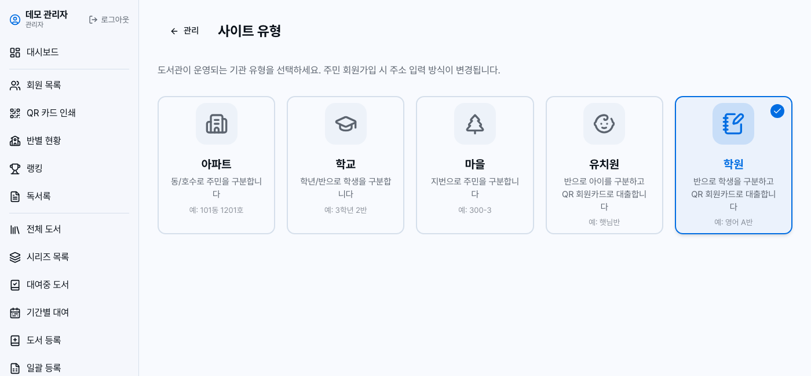

<a id="academy-ar-settings"></a>

### 2. 원서·AR 레벨 설정

**관리 → 원서·AR 레벨**에서 두 기능을 켜고 끕니다. 둘 다 사이트 유형과 별개라 아파트·학교 도서관에서도 쓸 수 있습니다.

- **AR 레벨 정보 사용** — 도서 등록·수정 화면에 AR 칸이 생기고, 학생 도서 검색에서 레벨로 찾고 레벨순으로 볼 수 있습니다. 꺼도 입력해 둔 AR 정보는 지워지지 않고 화면에서만 숨겨집니다.
- **Open Library 보충 조회** — 바코드(ISBN)로 책을 찾을 때 카카오 도서 검색에 없는 원서는 Open Library(해외 도서 정보)에서 제목·저자·출판사·표지를 가져옵니다.

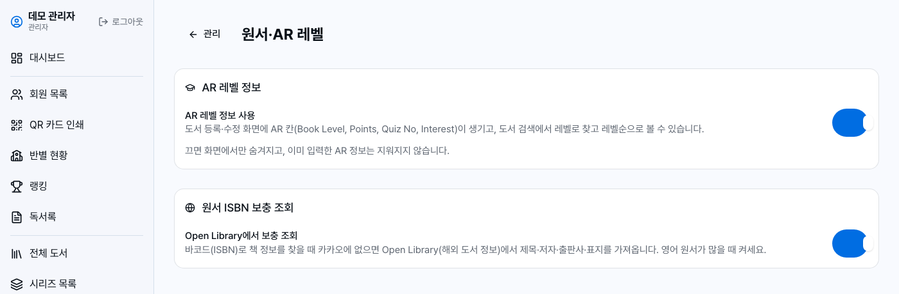

<a id="academy-book"></a>

### 3. 책마다 AR 정보 (Book Level · Points · Quiz No · Interest)

도서 등록·수정 화면에 **AR 정보** 칸(Book Level, Points, Quiz No, Interest, 단어 수, Lexile)이 생깁니다. **AR 찾기**를 누르면 책 제목이 복사되고 AR BookFinder가 열려서 값을 확인해 옮겨 적을 수 있습니다. 도서 상세에는 `BL 4.4 · 5.0 pts · Quiz #…` 배지로 보입니다.

> **AR 정보는 자동으로 가져오지 않습니다.** AR 정보를 관리하는 Renaissance는 공개 API를 제공하지 않습니다. 그래서 학원이 이미 가진 AR 목록(엑셀)을 [일괄 등록](#academy-import)으로 붙여 넣거나, AR BookFinder에서 확인해 직접 입력합니다.

<table>
  <tr>
    <td width="62%">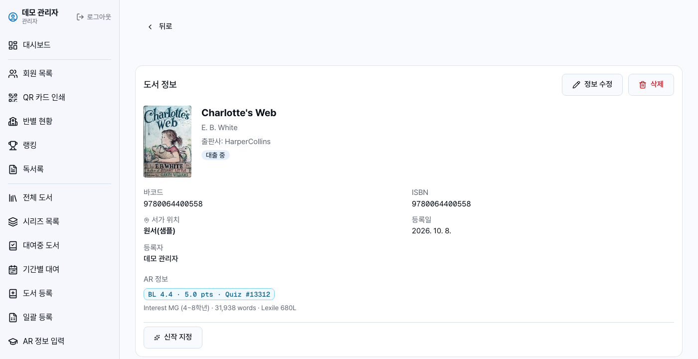</td>
    <td width="38%">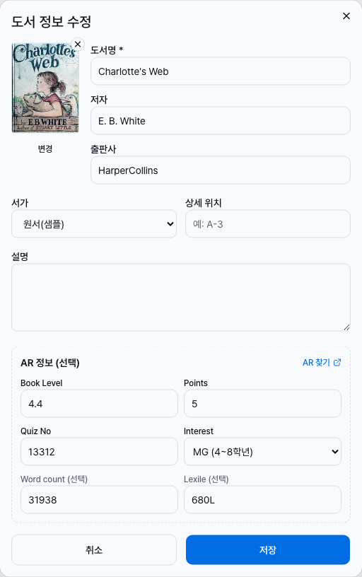</td>
  </tr>
  <tr>
    <td align="center">도서 상세 — BL · 포인트 · 퀴즈 번호 배지</td>
    <td align="center">정보 수정 — AR 칸과 'AR 찾기'</td>
  </tr>
</table>

<a id="academy-import"></a>

### 4. 엑셀(CSV) 일괄 등록 — 도서 · AR 정보 · 학생

**일괄 등록**에서 원서 목록, 이미 등록한 책의 AR 정보, 학생 명단을 한꺼번에 넣습니다. 엑셀에서 머리글 줄부터 표를 복사해 붙여 넣거나 CSV 파일을 고르고 **미리보기**를 누르면 줄마다 결과가 나옵니다(OK / 이미 있는 책 / 없는 책장 등).

- ISBN만 있어도 책 정보(제목·저자·출판사·표지)를 찾아 빈 칸을 채웁니다. 엑셀에 적은 값이 먼저입니다.
- '이미 있는 책은 건너뛰기'를 켜 두면 같은 파일을 두 번 올려도 복본이 생기지 않습니다.
- 엑셀 파일(.xlsx)은 바로 읽지 못하므로 파일로 올릴 때는 CSV로 저장해 주세요.

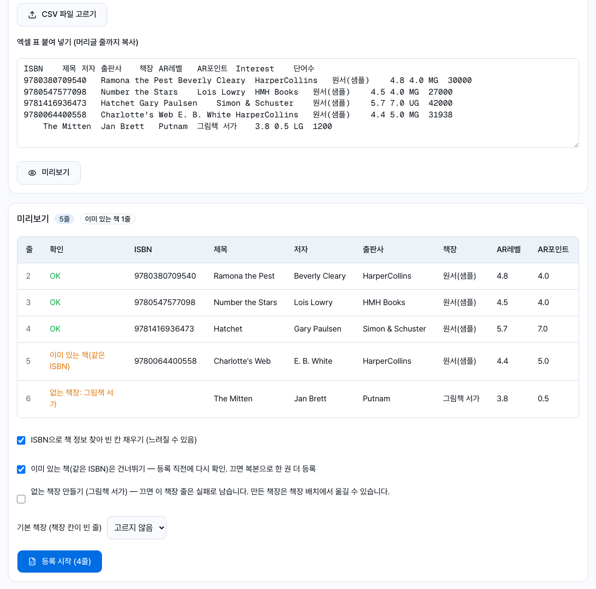

<a id="academy-ar-missing"></a>

### 5. AR 정보 없는 책 입력표

**AR 정보 입력**은 AR 레벨이 비어 있는 책만 모아 표로 보여 줍니다. 칸 사이는 Tab, 아래 줄 같은 칸은 Enter로 옮겨 가며 빠르게 입력하고 **한 번에 저장**합니다. 같은 ISBN의 복본은 한 줄로 묶여 함께 저장됩니다.

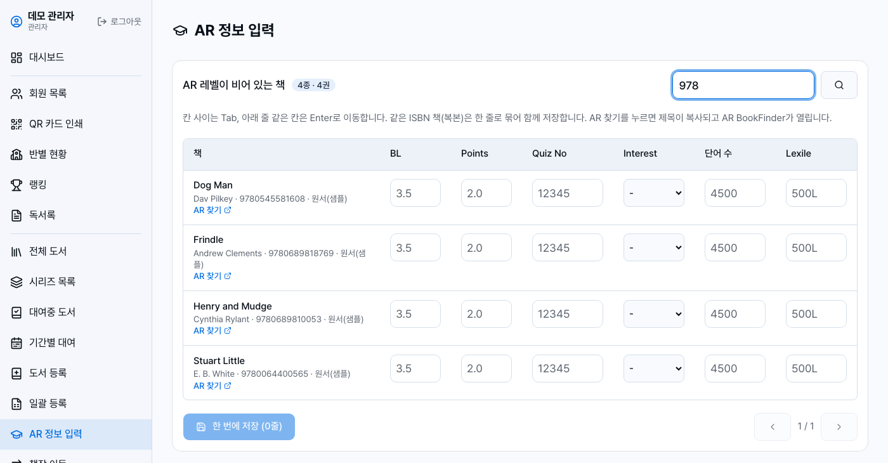

<a id="academy-classes"></a>

### 6. 반별 현황 — 대출 · 연체 · AR 통과

**반별 현황**에서 반마다 학생 수·대출·연체 권수를 보고, 반을 누르면 학생별 학년, 레벨(ZPD), 빌린 책과 반납 예정일(연체는 빨간색), 최근 30일 동안 반납한 책과 AR 통과 여부가 나옵니다. 여기서 바로 **AR 통과**를 체크할 수 있습니다.

학생을 골라 **반 이동**이나 **퇴원** 처리를 하고, **반 이름 변경**을 하면 그 반 학생들의 반도 함께 바뀝니다. 퇴원한 학생은 대출·카드 인쇄·랭킹에서 빠집니다.

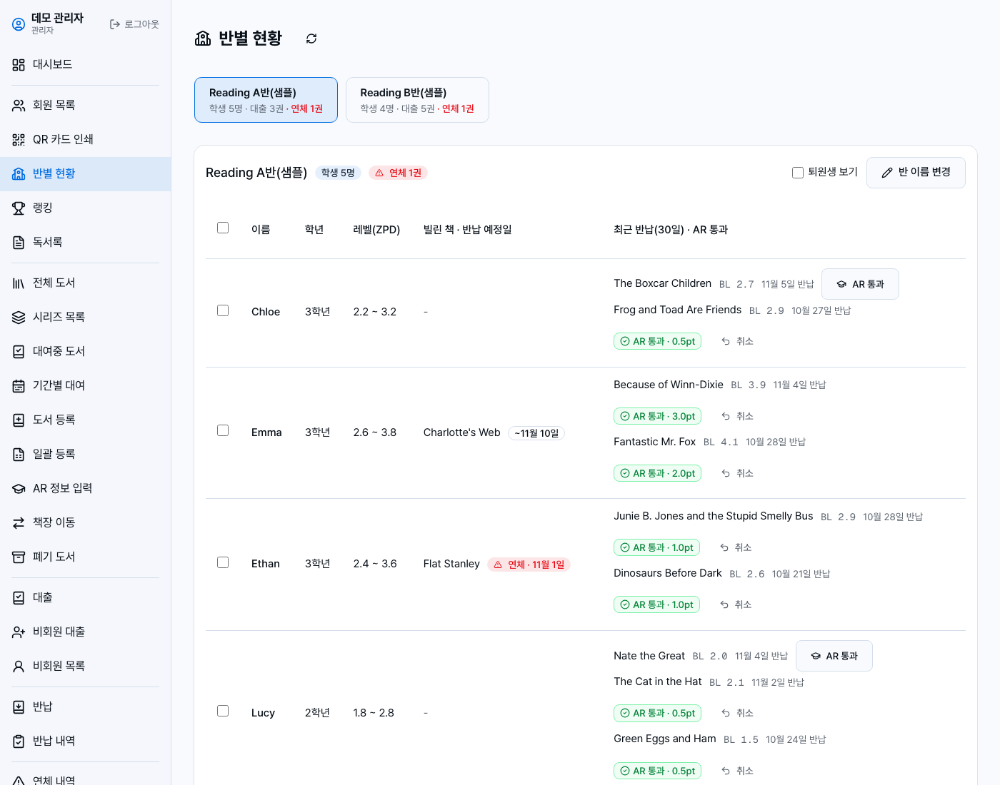

<a id="academy-return"></a>

### 7. 반납할 때 AR 퀴즈 통과 체크

**AR 퀴즈는 학생이 Renaissance(AR 프로그램)에서 풉니다.** 책빌리지는 퀴즈를 내거나 채점하지 않고, 선생님이 확인한 **통과 기록만** 남깁니다.

반납 화면에서 책 바코드를 찍으면 반납 완료 아래에 **AR 퀴즈** 상자가 나옵니다. **AR 퀴즈 통과 체크**를 누르면 그 책의 포인트와 단어 수가 학생 기록에 쌓입니다. 잘못 눌렀으면 취소할 수 있고, 젤리 포인트와는 연결되지 않습니다.

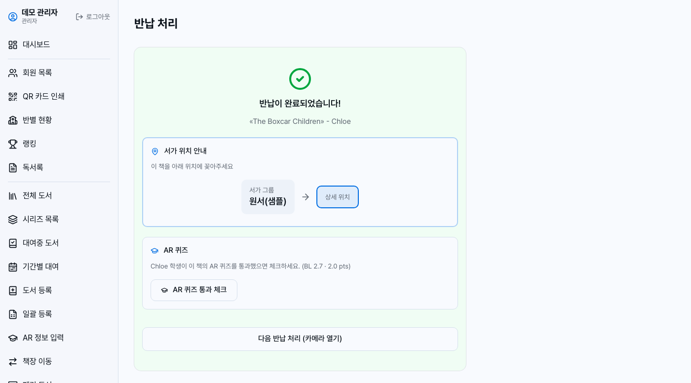

<a id="academy-ranking"></a>

### 8. AR 포인트 랭킹

**랭킹 → AR 포인트** 탭에서 기간·반별로 통과 권수, 읽은 단어 수, 포인트 순위를 봅니다. 선생님이 통과를 체크한 날(한국 시간) 기준이며 퇴원생은 빠집니다.

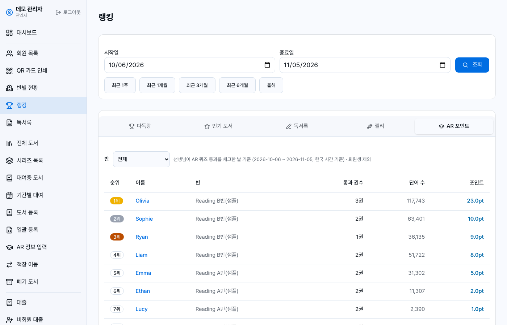

<a id="academy-student"></a>

### 9. 학생 상세 — 학년 · 레벨 · AR 통과 기록

회원 상세의 **학원 정보**에서 학년, 레벨 범위(ZPD), 재원/퇴원 상태를 고치고 통과 권수·누적 포인트·읽은 단어 수와 통과한 책 목록(체크한 선생님 포함)을 봅니다. **책 찾아서 통과 기록**으로 대출 기록이 없는 책(교실에서 읽은 책 등)도 찾아서 통과를 기록할 수 있습니다.

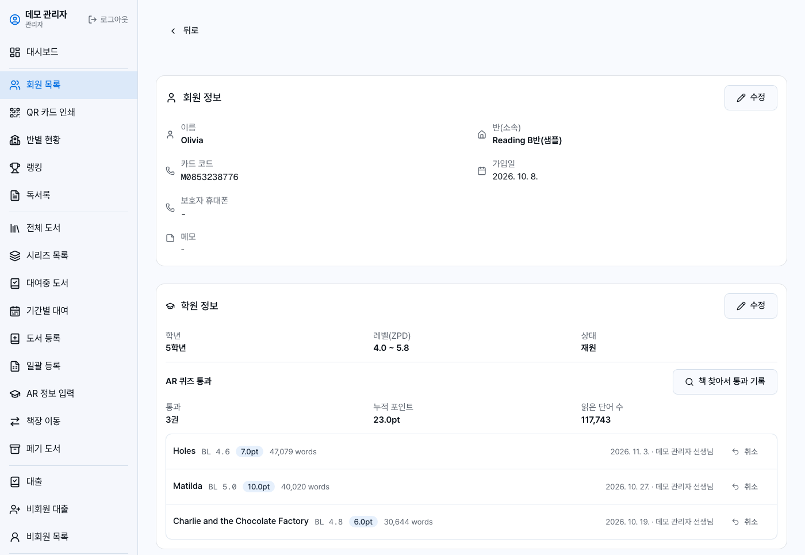

<a id="academy-labels"></a>

### 10. 레벨 라벨 인쇄

**레벨 라벨 인쇄**에서 책장과 레벨 범위를 골라 책등에 붙일 AR 레벨 라벨을 만듭니다. 라벨 하나는 23.5×36mm, A4 한 장에 56개(8개 × 7줄)이고 레벨대마다 색 띠가 달라 책장에서 레벨을 한눈에 볼 수 있습니다. 라벨 아래 칸(제목/바코드/없음)과 앞에서 비울 칸(쓰다 남은 라벨지 이어 쓰기)을 고를 수 있습니다.

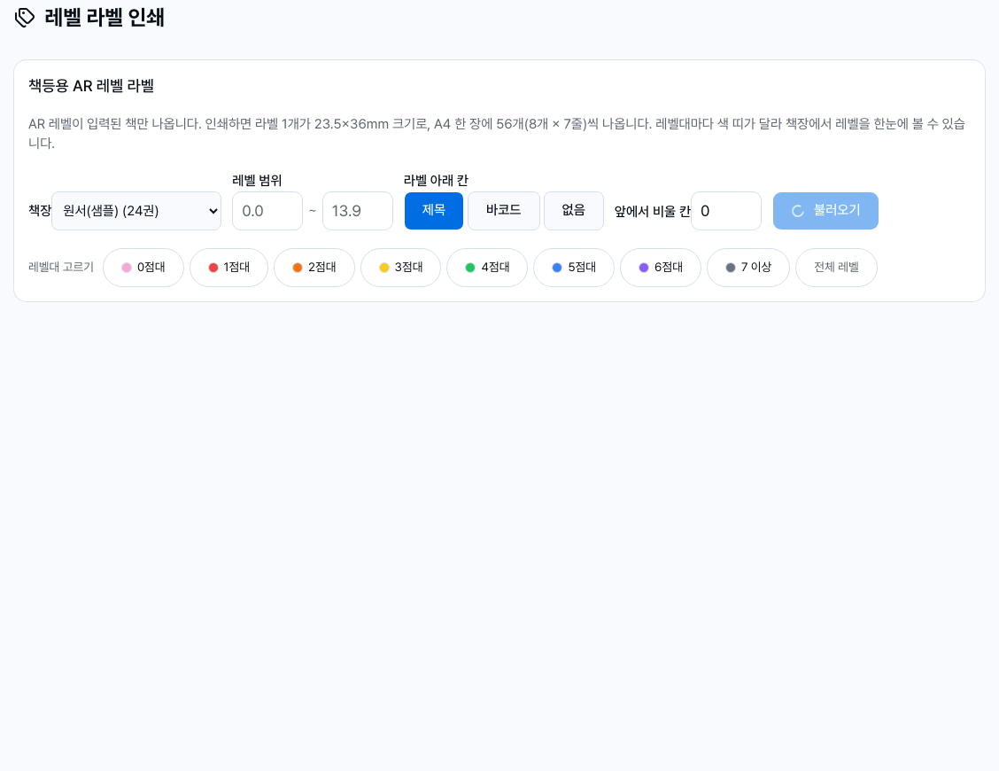

<a id="academy-student-app"></a>

### 11. 학생 화면 — 내 레벨 책 · BL 배지 · AR 독서 카드

학생이 QR 회원카드로 로그인하면 도서 검색에 **레벨 칩**(0점대~6 이상, Interest LG·MG·MG+·UG)과 레벨순 정렬이 생깁니다. **내 레벨 책**을 누르면 선생님이 정해 둔 레벨 범위(ZPD) 안의 책 중 지금 빌릴 수 있는 책만 보여 줍니다. 내 서재에는 퀴즈 통과 권수·포인트·읽은 단어 수가 담긴 **AR 독서** 카드가 나옵니다.

<table>
  <tr>
    <td width="33%">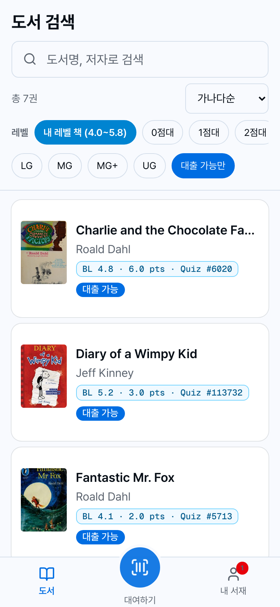</td>
    <td width="33%">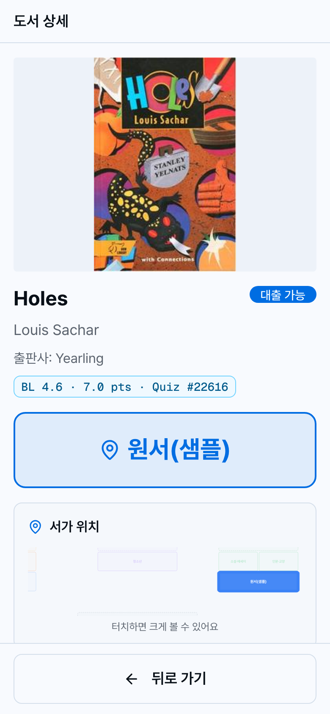</td>
    <td width="33%">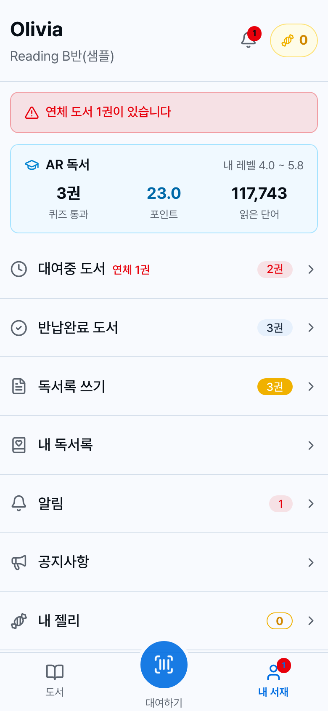</td>
  </tr>
  <tr>
    <td align="center">도서 검색 — 내 레벨 책 · BL 배지</td>
    <td align="center">책 상세 — 레벨·포인트·퀴즈 번호</td>
    <td align="center">내 서재 — AR 독서 카드</td>
  </tr>
</table>

<a id="academy-need"></a>

### 필요한 것

- **2D(QR) 바코드 리더기** — 학생이 QR 회원카드로 로그인합니다. 유치원 모드와 같은 일반 USB 리더기면 됩니다.
- **AR 정보 목록** — 학원이 가진 원서 AR 목록(엑셀)이나 AR BookFinder에서 확인한 값. 공개 API가 없어 자동으로 채워지지 않습니다.
- **AR 퀴즈 이용** — 퀴즈는 Renaissance에서 풉니다. 학원이 따로 이용 중이어야 하고, 책빌리지는 통과 기록만 합니다.
- 원서 바코드 — 책 뒤 ISBN 바코드를 그대로 쓰거나 **바코드 생성** 메뉴의 자체 바코드를 붙입니다. 레벨 라벨은 A4 용지에 인쇄해 잘라 붙이면 됩니다.

<sub>AR, Accelerated Reader, ATOS는 Renaissance Learning의 상표입니다. 책빌리지는 Renaissance와 관계가 없습니다.</sub>

## 기술 스택

| 영역 | 기술 |
|------|------|
| Frontend / Backend | Next.js 16 (App Router, TypeScript) |
| Database / Auth | Supabase (PostgreSQL, 15 테이블 + 2 뷰) |
| UI | shadcn/ui + Tailwind CSS 4 (Yellow 테마) |
| Deployment | Vercel (서울 리전) |
| External API | 카카오 도서 검색 API, Open Library (원서 보충 조회, 선택) |
| Barcode | html5-qrcode |

## 시작하기

```bash
git clone https://github.com/dean-studio/bookvillage_app.git
cd bookvillage
npm install
cp .env.example .env.local  # 환경변수 설정
npm run dev                  # http://localhost:6100
```

### 환경변수

```env
NEXT_PUBLIC_SUPABASE_URL=your_supabase_url
NEXT_PUBLIC_SUPABASE_ANON_KEY=your_supabase_anon_key
SUPABASE_SERVICE_ROLE_KEY=your_supabase_service_role_key
KAKAO_REST_API_KEY=your_kakao_rest_api_key
```

### 데이터베이스

```bash
npx supabase link --project-ref YOUR_PROJECT_REF
npx supabase db push
```

## 사이트맵

### 주민 (Mobile/Tablet 반응형)

| 경로 | 설명 |
|------|------|
| `/login` | 퍼널형 로그인/회원가입 |
| `/rent` | 대여하기 (바코드 스캔, 인기검색어) |
| `/books` | 도서 검색 + 필터 |
| `/books/[id]` | 도서 상세 (서가 위치, 추천) |
| `/mypage` | 내 서재 메뉴 |
| `/mypage/rentals` | 대여중 도서 |
| `/mypage/returned` | 반납완료 (퀴즈, 독서록 작성) |
| `/mypage/reports` | 내 독서록 모아보기 |
| `/mypage/notifications` | 알림 |
| `/mypage/notices` | 공지사항 |
| `/mypage/jelly` | 젤리 |

### 관리자 (Tablet/PC)

| 경로 | 설명 |
|------|------|
| `/admin` | 대시보드 |
| `/admin/residents` | 주민 목록 |
| `/admin/residents/[id]` | 주민 상세 (PIN 재설정, QR 카드 재발급) |
| `/admin/residents/new` | 회원 추가 (유치원·학원 모드, QR 카드 발급, 학원은 학년·레벨) |
| `/admin/residents/cards` | QR 회원카드 인쇄 (A4 10장) |
| `/admin/rankings` | 랭킹 (학원 모드: AR 포인트 탭) |
| `/admin/academy/classes` | 반별 현황 (학원 모드: 대출·연체·AR 통과, 반 이름 변경·반 이동·퇴원) |
| `/admin/reports` | 독서록 열람 |
| `/admin/books` | 도서 목록 |
| `/admin/books/series` | 시리즈 목록 (인기순, 마지막 권·빠진 권) |
| `/admin/books/move` | 책장 이동 |
| `/admin/books/disposal` | 폐기 도서 |
| `/admin/books/[id]` | 도서 상세 (정보 수정) |
| `/admin/books/new` | 도서 등록 + 서가 관리 |
| `/admin/books/barcodes` | 자체 바코드 생성·인쇄 |
| `/admin/books/logo-print` | 로고 인쇄 |
| `/admin/academy/import` | 엑셀(CSV) 일괄 등록 — 도서·AR 정보·학생 (학원 모드) |
| `/admin/academy/ar-missing` | AR 정보 없는 책 입력표 (학원 모드) |
| `/admin/academy/level-labels` | AR 레벨 라벨 인쇄 (학원 모드) |
| `/admin/rentals` | 대여중 도서 |
| `/admin/rentals/period` | 기간별 대여 도서 |
| `/admin/checkout` | 대출 처리 |
| `/admin/guest-checkout` | 비회원(게스트) 대출 |
| `/admin/guests` | 비회원 목록 (수정·합치기·삭제) |
| `/admin/return` | 반납 처리 |
| `/admin/returns` | 반납 내역 |
| `/admin/overdue` | 연체 관리 |
| `/admin/notices` | 공지사항 관리 |
| `/admin/new-arrivals` | 월별 신간도서 관리 |
| `/admin/new-arrivals/print` | 신간도서 A4 인쇄 |
| `/admin/receipts` | 구매 영수증 관리 |
| `/admin/receipts/print` | 구매 영수증 인쇄 |
| `/admin/deletions` | 도서 삭제내역 |
| `/admin/files` | 자료실 |
| `/admin/manage` | 설정 관리 |
| `/admin/manage/site-type` | 사이트 유형 (아파트·학교·마을·유치원·학원) |
| `/admin/manage/access` | 로그인·대출 방식 (QR 카드, 리더기 대출, 반 목록) |
| `/admin/manage/ar` | 원서·AR 레벨 (AR 정보 사용, Open Library 보충 조회) |

## 문서

상세 기능 안내와 가이드는 [문서 사이트](https://dean-studio.github.io/bookvillage_app/)에서 확인할 수 있습니다.

```bash
npm run docs:dev  # 문서 로컬 미리보기
```

## 문서 사이트 로컬 실행

```bash
npm run docs:dev  # http://localhost:6200/bookvillage/
```

## 개발

**딘웍스** | [dean.kr](https://dean.kr) | hckim@dean.kr

## 라이선스

MIT + [Commons Clause](https://commonsclause.com/)

자유롭게 사용, 수정, 배포할 수 있지만 **이 소프트웨어 자체를 유료로 판매하는 것은 금지**됩니다. 자세한 내용은 [LICENSE](LICENSE) 파일을 참고하세요.
