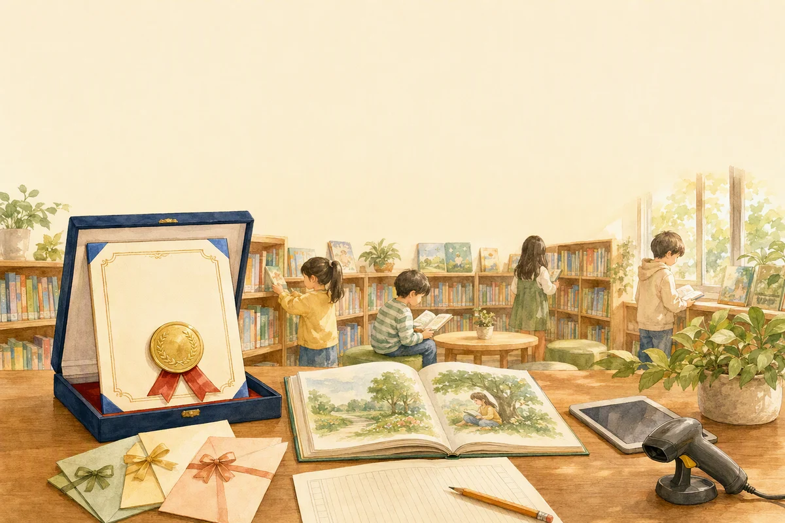

# 책빌리지 1호점, 첫 독후감 대회를 열었어요 📚

안녕하세요, 책빌리지입니다.

책빌리지를 설치한 아파트 도서관에서 아이들과 독후감 대회를 열고 싶다는 연락을 받았어요.
그래서 책빌리지에 **독후감 기능**을 새로 만들었고, 아이들이 앱에서 바로 독후감을 쓰고 낼 수 있게 됐습니다.

## 열심히 참여한 아이들에게 작은 선물을 준비했어요 🎁

상장은 하드케이스에 넣고 금색 패치와 리본을 하나하나 달았어요.
이번 대회를 계기로 아이들이 책 읽는 걸 조금 더 좋아해 주면 좋겠다는 마음을 담았습니다.

[사진: 상장 + 하드케이스]

선물로 드릴 문화상품권도 준비했는데, 요즘은 구하기가 생각보다 어렵다는 걸 이번에 처음 알았어요.
마침 9월 말부터 **우체국에서 문화상품권을 판매**한다고 해서 우체국에서 사 왔습니다.
혹시 구하기 어려우셨던 분들은 참고하세요!
👉 https://blog.naver.com/kpostbank/224421009932

[사진: 문화상품권]

## 석 달도 안 돼서 700권이 대여됐어요 📖

그동안 몇 권이나 빌려 갔는지 궁금해서 여쭤보니, 오픈한 지 석 달도 안 됐는데 **벌써 700권 정도가 대여**됐다고 해요.
반납도 아주 잘 되고 있다고 하니 정말 뿌듯했습니다.

## 책빌리지는 재능기부로 운영하고 있어요 🙂

혹시 궁금해하실 분들이 계실 것 같아 말씀드리면, 책빌리지는 **설치부터 간단한 기능 추가까지 모두 무료**로 해드리고 있어요.
아이들이 책과 조금 더 가까워지는 데 보탬이 되고 싶어서 시작한 일이라, 재능기부로 함께하고 있습니다.

우리 아파트나 어린이집에도 책빌리지를 들이고 싶으시면 댓글로 편하게 문의 주세요 😊

#책빌리지 #아파트도서관 #독후감대회 #어린이독서 #문화상품권 #우체국문화상품권 #재능기부
